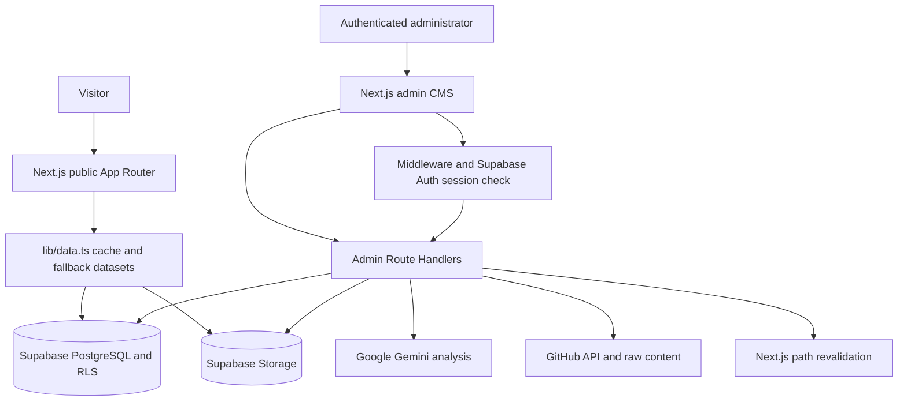

# Babul Kumar Portfolio

An AI/ML and full-stack engineering portfolio with a public showcase and a private Supabase-backed management CMS. It presents projects, credentials, training, co-curricular work, education, experience, skills, and an interactive resume while providing authenticated tools for maintaining content and using Gemini to turn uploaded documents or GitHub repositories into structured drafts.

## Overview

This project combines a recruiter-facing portfolio with an operational content system. Public pages read published records from Supabase, render project case studies and credential media, and fall back to typed in-repository seed data when a database is unavailable. Authenticated administrators can manage portfolio records, upload media, review contact inquiries, synchronize baseline data, and refresh cached public paths.

The implementation is notable for its resilient data layer, explicit Row Level Security policies, server-side separation of privileged Supabase access, multimodal document extraction, GitHub repository analysis with API fallbacks, and an editorial visual system with responsive ambient motion and selective WebGL scenes.

## Key Features

- Public portfolio homepage with hero, profile, selected work, skills, education, experience, achievements, credentials, training, and contact sections.
- Dedicated public archives and detail pages for work, certificates, training, and co-curricular activities.
- Project case studies with problem, solution, architecture, engineering trade-offs, results, technologies, and media fields.
- Interactive certificate and training media supporting images, PDFs, lightboxes, and verification links.
- Interactive resume view backed by profile, skills, education, and featured project data, with Supabase Storage document support.
- Authenticated `/admin` CMS for projects, certificates, training, co-curricular activities, achievements, education, experience, skills, profile, settings, and contact messages.
- Supabase Auth session protection in middleware and server-side authorization checks for admin API routes.
- Gemini multimodal extraction for certificate, training, and co-curricular documents, including structured fields, confidence scores, warnings, recipient matching, and duplicate detection.
- GitHub repository analyzer that reads repository metadata, README content, dependency manifests, and candidate screenshots to produce validated project drafts.
- GitHub REST API integration with public HTML/raw-content fallbacks when unauthenticated API access is rate-limited.
- Supabase Storage uploads with MIME/size validation, path sanitization, public asset URL normalization, and non-blocking cleanup of missing files.
- Zod validation for contact forms, CMS forms, GitHub analysis input, and untrusted AI output.
- IP-based rate limiting for the public contact endpoint: three submissions per minute per observed IP.
- Responsive dark/light themes, reduced-motion handling, page transitions, cursor interactions, ambient grid/glow layers, and animated telemetry-style visual elements.
- React Three Fiber scenes for the certificate stack, plus an interactive technology constellation built with HTML/CSS/SVG.

## Tech Stack

| Category | Technology |
| --- | --- |
| Framework | Next.js 16.3.1 App Router |
| Language | TypeScript with strict checking |
| UI | React 19.2.8 |
| Styling | CSS custom properties, inline component styles, Tailwind CSS 4 via PostCSS |
| Motion | Framer Motion, CSS keyframes, `requestAnimationFrame` loops |
| 3D/WebGL | Three.js, React Three Fiber, `@react-three/drei` |
| Icons | Lucide React |
| Forms and validation | React Hook Form, Zod, `@hookform/resolvers` |
| Backend | Next.js Server Components and Route Handlers |
| Database | Supabase PostgreSQL |
| Authentication | Supabase Auth with `@supabase/ssr` |
| Storage | Supabase Storage with RLS policies |
| AI | Google Gemini through `@google/genai` |
| External APIs | GitHub REST API and public HTML/raw content fallback |
| Image processing | Next Image and Sharp |
| Package manager | npm (`package-lock.json`) |

## Architecture

The application uses server-rendered Next.js pages for public content, client components for interactive views, and a shared server data layer for Supabase access and fallback behavior. Public reads use the anon client and are constrained by published-record RLS policies. Admin mutations use authenticated sessions and, where required, server-only service-role utilities.



### Data and caching

`lib/data.ts` centralizes reads for profiles, projects, certificates, training, co-curricular activities, achievements, education, experience, skills, settings, and dashboard statistics. Successful reads are cached in memory for 60 seconds. When Supabase is not configured, a request fails, or a configured dataset is unavailable, the data layer can use typed fallback datasets in the same module. Public collection pages generally use 60-second Next.js revalidation; the resume is explicitly dynamic.

### Authentication and authorization

`middleware.ts` matches `/admin/:path*`, allows the login page, redirects unauthenticated requests to `/admin/login`, and refreshes Supabase SSR cookies for authenticated sessions. Admin route handlers repeat server-side session checks. The service-role key is used only in server utilities and must never be exposed to client code.

### AI and GitHub workflows

The document analyzer accepts supported certificate/document images and PDFs, uploads them when storage is available, sends the bytes to Gemini, parses JSON, validates the result with Zod, verifies the recipient name against the portfolio profile, and checks for likely duplicate credentials. The GitHub analyzer validates a repository URL, fetches metadata and source documentation, normalizes dependencies, sends the evidence to Gemini, validates the structured response, and caches the analysis in memory.

## Public Routes

| Route | Purpose |
| --- | --- |
| `/` | Portfolio homepage and interactive hero/profile overview |
| `/about` | Permanent redirect to `/` |
| `/work` | Project archive and showcase |
| `/work/[slug]` | Project systems-architecture case study |
| `/projects` | Compatibility redirect to `/work` |
| `/projects/[slug]` | Compatibility redirect to `/work/[slug]` |
| `/certificates` | Published credentials archive |
| `/certificates/[slug]` | Certificate detail and document view |
| `/training` | Published training archive |
| `/training/[slug]` | Training detail and certificate/media view |
| `/co-curricular` | Published activities, events, and leadership archive |
| `/co-curricular/[slug]` | Activity detail page |
| `/achievements` | Published achievements archive |
| `/education` | Education history |
| `/experience` | Experience history |
| `/contact` | Public contact form |
| `/resume` | Dynamic resume and downloadable document view |

## Admin Surface

The `/admin` area contains a dashboard and management screens for:

- Projects, including GitHub-assisted project drafting.
- Certificates, including AI-assisted document analysis.
- Training and co-curricular activities, including create/edit/delete flows.
- Achievements, education, experience, skills, profile, and site settings.
- Contact inquiries and publication/featured-state management.
- Uploads, storage cleanup, synchronization, and on-demand cache revalidation.

Admin access starts at `/admin/login` and uses Supabase email/password authentication. The admin UI can render locally without configured Supabase credentials for UI work, but persistence and protected production behavior require a configured Supabase project.

## API Routes

| Route | Behavior |
| --- | --- |
| `POST /api/contact` | Validates and rate-limits public contact submissions before inserting them into `contact_messages` |
| `POST /api/admin/ai/analyze-certificate` | Uploads and analyzes certificate, training, or co-curricular documents with Gemini |
| `POST /api/admin/certificates/analyze` | Certificate analysis endpoint used by the certificate workflow |
| `POST /api/admin/projects/analyze-github` | Fetches and analyzes a GitHub repository into a project draft |
| `POST /api/admin/upload` | Validates and uploads supported media/documents to Supabase Storage |
| `DELETE /api/admin/training/[id]` | Authenticated training deletion with storage cleanup and revalidation |
| `DELETE /api/admin/co-curricular/[id]` | Authenticated co-curricular deletion with storage cleanup and revalidation |
| `GET/POST /api/admin/messages` | Admin contact-inquiry access and mutation workflow |
| `POST /api/admin/sync` | Synchronizes baseline fallback content into the configured database |
| `POST /api/admin/revalidate` | Clears relevant in-memory data caches and revalidates public paths |

## Project Structure

```text
portfolio/
├── app/
│   ├── (public)/                  Public portfolio routes and detail pages
│   ├── admin/                     Authenticated CMS screens
│   ├── api/                       Contact and admin route handlers
│   ├── layout.tsx                 Root metadata, theme bootstrap, and viewport
│   ├── globals.css                Theme tokens, layout utilities, and animations
│   ├── robots.ts                  Robots metadata
│   └── sitemap.ts                 Dynamic sitemap generation
├── components/
│   ├── 3d/                        React Three Fiber certificate scene
│   ├── admin/                     CMS shell, forms, uploads, and status UI
│   ├── hero/                      Avatar, ambient AI environment, and hero background
│   ├── layout/                    Navbar, footer, transitions, cursor, and page chrome
│   ├── projects/                  Project archive and media interactions
│   ├── resume/                    Resume client view and sections
│   ├── sections/                  Homepage and portfolio content sections
│   ├── training/                  Training cards and document media
│   └── ui/                        Shared modal and preview primitives
├── lib/
│   ├── ai/                        Gemini document and GitHub analyzers
│   ├── github/                    URL parsing, fetching, cleaning, caching, normalization
│   ├── supabase/                  Public, server, admin, and storage clients
│   ├── data.ts                    Typed queries, cache, and fallback datasets
│   ├── validations/               Zod schemas and form/category validation
│   └── utils.ts                   Formatting and shared helpers
├── public/                        Local avatar, Open Graph, verification, and static assets
├── supabase/migrations/            PostgreSQL schema, seed, RLS, and storage policies
├── types/index.ts                  Shared domain and AI response types
├── middleware.ts                   `/admin` authentication boundary
├── next.config.ts                 Image, headers, redirects, base path, and build flags
├── package.json                   Dependencies and npm scripts
├── package-lock.json              Locked npm dependency tree
└── README.md                      Project documentation
```

## Local Development

### Prerequisites

- Node.js compatible with the installed Next.js 16 toolchain.
- npm.
- A Supabase project for persistent content, authentication, and storage.
- A Gemini API key for the AI-assisted admin workflows.

### Install

```bash
npm install
```

### Configure environment variables

Create `.env.local` at the repository root. There is no committed `.env.example`; use the names below and keep all secret values out of source control.

| Variable | Required | Purpose |
| --- | --- | --- |
| `NEXT_PUBLIC_SUPABASE_URL` | Production data/auth | Supabase project URL |
| `NEXT_PUBLIC_SUPABASE_ANON_KEY` | Production data/auth | Public Supabase anon/publishable key |
| `SUPABASE_SERVICE_ROLE_KEY` | Server admin operations | Server-only privileged Supabase access |
| `GEMINI_API_KEY` | AI workflows | Server-side Google Gemini authentication |
| `GEMINI_MODEL` | Optional | Overrides the primary document-analysis model; defaults to `gemini-2.5-flash` |
| `GITHUB_TOKEN` | Optional | Authenticated GitHub API requests and higher rate limits |
| `GITHUB_API_KEY` | Optional alias | Alternate GitHub token variable accepted by the fetcher |
| `NEXT_PUBLIC_SITE_URL` | Optional | Canonical metadata, robots, and sitemap URL; defaults to `https://babul.dev` |
| `NEXT_PUBLIC_BASE_PATH` | Optional | Next.js base path for a subpath deployment |
| `NEXT_PUBLIC_UNOPTIMIZED_IMAGES` | Optional | Disables Next image optimization when set to `true` |
| `GITHUB_PAGES` | Optional | Enables the same unoptimized-image build mode when set to `true` |
| `BUILD_TARGET` | Optional | Enables the same mode when set to `static` |

Do not expose `SUPABASE_SERVICE_ROLE_KEY`, `GEMINI_API_KEY`, or `GITHUB_TOKEN` through a `NEXT_PUBLIC_` variable.

### Apply the database migrations

Run the SQL files in `supabase/migrations/` in filename order using the Supabase SQL Editor or an equivalent migration workflow:

1. `001_schema.sql` creates the core portfolio tables and indexes.
2. `002_rls.sql` enables table-level Row Level Security and public/admin policies.
3. `003_seed.sql` inserts the baseline profile, projects, skills, education, and social links.
4. `003_storage_policies.sql` defines public-read and authenticated-write storage policies.
5. `004_training.sql` adds the training table and policies.
6. `005_co_curricular_activities.sql` adds co-curricular activities, policies, and baseline records.
7. `006_fix_training_and_storage_rls.sql` applies explicit CRUD policies and storage policy corrections.

The application normalizes several legacy storage bucket aliases to the `certificate` bucket. Make sure the required public storage bucket(s) exist before enabling uploads in production.

### Run the application

```bash
npm run dev
```

Open [http://localhost:3000](http://localhost:3000). Public pages can use typed fallback datasets when Supabase is not configured; the CMS, persistence, authentication, uploads, and AI workflows require their corresponding services and environment variables.

## Scripts

| Command | Purpose |
| --- | --- |
| `npm run dev` | Start the Next.js development server |
| `npm run lint` | Run ESLint using the repository configuration |
| `npx tsc --noEmit` | Run the strict TypeScript check |
| `npm run build` | Create a production Next.js build |
| `npm run start` | Start the production server after `npm run build` |

## Build and Deployment

The repository does not include a provider-specific deployment manifest, CI workflow, or license file. The generic deployment flow is:

```bash
npm ci
npm run lint
npx tsc --noEmit
npm run build
npm run start
```

Configure production environment variables before starting the server. `next.config.ts` includes security headers, trailing-slash behavior, optional base-path support, Supabase image remote patterns, and flags for unoptimized images in static-oriented environments. Because the project includes Next.js route handlers, Supabase Auth, admin mutations, uploads, and Gemini integrations, a deployment must support a Next.js server/runtime for the full application; the static flags alone do not convert the CMS into a fully static site.

## Security and Reliability Notes

- Public database reads are restricted to published records by Supabase RLS policies.
- Admin writes and contact-message reads are restricted to authenticated users.
- Service-role access is isolated to server-side modules.
- Uploaded images/documents are restricted by MIME type and size; generated paths remove traversal patterns and unsafe characters.
- AI responses are treated as untrusted input and validated with Zod before use.
- The contact endpoint validates name, email, and message length and applies an in-memory IP rate limit.
- Public data access has timeout handling, a 60-second in-memory cache, and typed fallback content for degraded/local operation.
- `next.config.ts` sends `X-Frame-Options: DENY`, `X-Content-Type-Options: nosniff`, a strict referrer policy, and a restrictive permissions policy.

## Documentation and Verification

The repository also contains implementation notes and QA reports covering data synchronization, training and co-curricular CRUD flows, certificate media behavior, RLS/storage hardening, responsive checks, and prior production-build verification:

- `QA_AUDIT_REPORT.md`
- `QA_TRAINING_DELETE_REPORT.md`
- `TRAINING_PUBLIC_SYNC_FIX_REPORT.md`
- `walkthrough.md`

These reports are historical project documentation; run the current commands in [Scripts](#scripts) against the current checkout when making release decisions.
